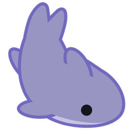

<p align="center">
  
</p>
<h1 align="center">Kawari</h1>

Kawari is a native Linux app for Live2D avatars and livestreaming. Load a Live2D model, configure tracking and expressions, add props to your scene, and send video with a transparent background to OBS over PipeWire.

**P0.5h3 · Prototype · Linux x86-64**

[Install](#install-on-arch-linux) · [Build](#build-on-arch-linux) · [Launch](#first-launch) · [OBS](#stream-to-obs) · [Integrations](#integrations)

## Features

| Area | What you can do |
| --- | --- |
| **Live2D models** | Open `.model3.json` models, switch between them from the model library, configure tracking and physics, and control animation playback. |
| **Expressions and hotkeys** | Create expressions that change model parameters and item visibility. Set fade-in and fade-out durations, assign hotkeys, and make expressions mutually exclusive. |
| **Scene items** | Import PNGs and GIFs, layer them in front of or behind the model, and adjust their size, rotation, and opacity. Attach items to the model root so they follow its position and scale. |
| **Workspace** | Dock panels on the right or open them as floating windows. Docked panels overlay the preview while the model keeps its position and scale. |
| **Video output** | Send video with an alpha channel over PipeWire using DMA-BUF. Set the stream resolution independently of the window size. |
| **Integrations** | Connect VBridger and other clients through Kawari's partial implementation of the VTube Studio Public API. Bind Twitch Channel Points rewards to expressions. |

## Install on Arch Linux

Set up the [Cubism SDK](#2-set-up-the-cubism-sdk), then run the following from the project root as your normal user. `makepkg` builds the local package, installs its dependencies and prompts for permission to install it through pacman.

```bash
sudo pacman -S --needed base-devel
makepkg -si
```

Launch **Kawari** from your application menu or run `kawari`. If you previously installed the per-user launcher from a source checkout, move it aside with `./scripts/install-portal-identity.sh --installed` so your desktop uses the packaged launcher.

Use `makepkg -fsi` to rebuild and reinstall the same package version after a source update. To uninstall, run `sudo pacman -R kawari`. Your models and profiles remain in your user directories.

## Build on Arch Linux

### 1. Install dependencies

Install the packages below to build with PipeWire support. You also need a Vulkan driver for your GPU. Use `vulkaninfo --summary` to check which GPU Vulkan detects.

```bash
sudo pacman -S --needed \
  base-devel rust cmake meson ninja git python pkgconf shaderc \
  vulkan-headers vulkan-icd-loader vulkan-tools \
  pipewire libdrm mesa wayland wayland-protocols libxkbcommon \
  libx11 libxrandr libxinerama libxcursor libxi libxext \
  libpng giflib ttf-dejavu
```

### 2. Set up the Cubism SDK

Download **Cubism 5 SDK for Native R5** (`5-r.5`). The extracted SDK root should contain `Core`, `Framework`, and `Samples`. Place it in `vendor/cubism-sdk` or set `CUBISM_SDK_ROOT` to its location. [Download the SDK from Live2D](https://www.live2d.com/en/sdk/download/native/)

### 3. Build Kawari

Run this command from the project root to build the renderer, application core, and WebSocket API with PipeWire support.

```bash
./scripts/build.sh
```

The build patches a copy of the Cubism SDK in `build/sdk` and fetches pinned dependencies such as libfunnel and Dear ImGui when needed. If you update the SDK or move it, run `./scripts/build.sh --clean-native`.

## First launch

On the first launch, Kawari opens Haru when the Cubism sample is available. On later launches, it opens the last available model. For a source build, run this command from the project root.

```bash
./scripts/run-kawari.sh
```

Open **Model Library** to switch to your own model. You can also pass its original `.model3.json` path to `kawari` or `./scripts/run-kawari.sh`, or use `--library-dir` to add a folder of models. Pass `--help` for all launch options.

To launch a source build from your application menu, install its launcher and icon. Run the command again if you move the project folder.

```bash
./scripts/install-portal-identity.sh
```

## Stream to OBS

1. Install the PipeWire video source plugin for OBS. [obs-pwvideo](https://github.com/hoshinolina/obs-pwvideo)
2. Start Kawari.
3. Add the plugin's PipeWire video source in OBS and select **Live2D**.

Set the stream resolution and target frame rate under **Settings → Broadcast**. Changes to either setting take effect the next time you start Kawari. Run `./scripts/broadcast-status.sh` to check whether Kawari is publishing the stream.

Use `--no-preview` to stream with the preview window hidden. If you saved that mode as your default, pass `--preview` to show the window for one launch.

## Integrations

- **VBridger and plugins.** Connect to `ws://127.0.0.1:8001`, or use the port you passed to Kawari with `--port`. Approve the client's request under **Integrations → Plugins**.
- **Twitch.** The local package includes the Twitch helper. For a source build, install `curl`, `json-c`, and `xdg-utils`, then run `./scripts/build-twitch.sh`. In **Integrations → Twitch**, enter the Client ID of a **Public** Twitch application and click **Connect**. Kawari remembers the Client ID and opens the Twitch authorization page. You can reopen the page or copy the link and code from the panel. On first use, approve **Kawari Twitch** in **Integrations → Plugins**. You can then bind a Channel Points reward to an expression. In **Timed** mode, the countdown shows how long remains before the expression starts fading out. Kawari retries temporary connection failures automatically. [Twitch Developer Console](https://dev.twitch.tv/console/apps)
  Kawari renews your saved Twitch login while the integration is enabled. Twitch's Public app refresh tokens expire after 30 days without renewal, so a long break can require signing in again.
- **OBS scene positions.** In **Expressions & Hotkeys**, open an expression and enable **Move model** in the **Position** tab. Enter X and Y or capture the current placement, enable **Change scale** if needed, then set the transition speed. OBS applies the position and scale saved in the expression. Enable OBS's WebSocket server under **Tools → WebSocket Server Settings**. Connect in **Integrations → OBS** using the server port (4455 by default) and password. Bind a program scene to a saved expression and set the delay in milliseconds from the start of the OBS transition to line up movement with a stinger. Bindings are saved per model and use the scene name. [OBS remote control guide](https://obsproject.com/kb/remote-control-guide)
- **Global hotkeys.** The local package includes the shortcut helper. For a source build, build it with `./scripts/build-global-shortcuts.sh`. On X11, enable **Global** for an assigned hotkey. On Wayland, global registration is experimental and disabled by default.

## Data and settings

Kawari stores its data in `~/.local/share/kawari/` by default, or in `$XDG_DATA_HOME/kawari/` when that variable is set. Each model has a separate profile under `profiles/` for its parameters, expressions, and hotkeys. Kawari automatically saves each model’s manual position and scale and restores them when you load it again. Interface settings, broadcast settings, and scene items are shared across models. Kawari treats your original model files as read-only.
